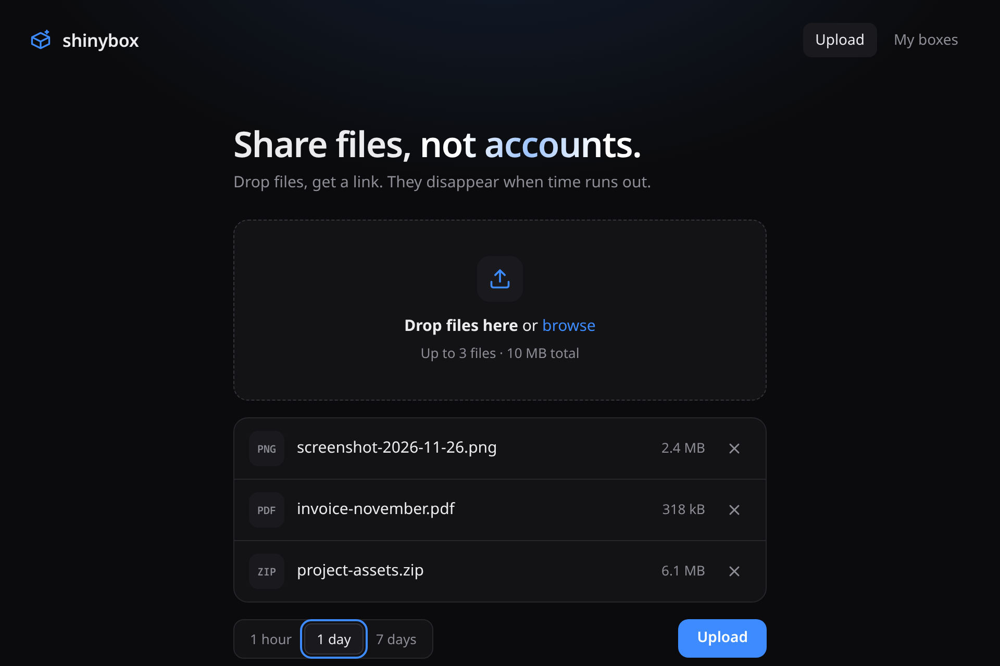
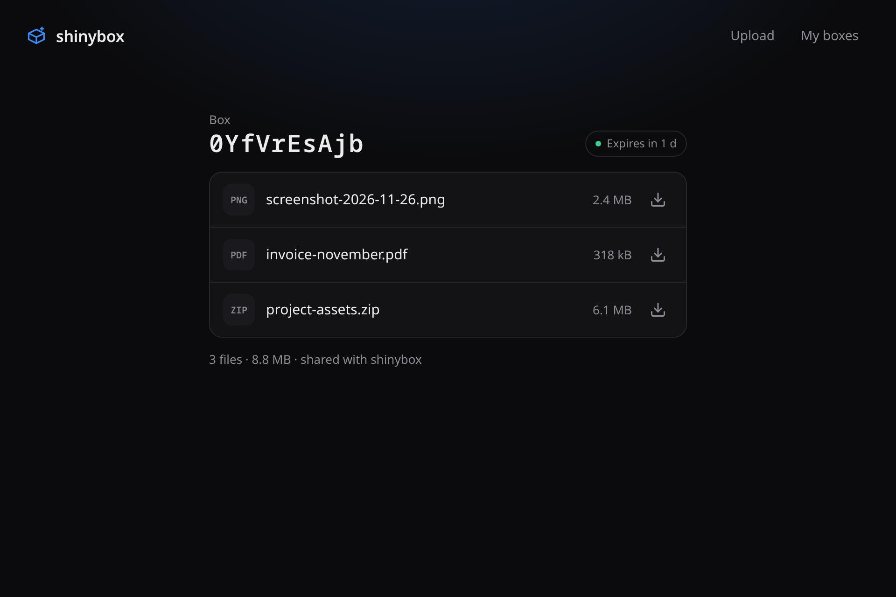
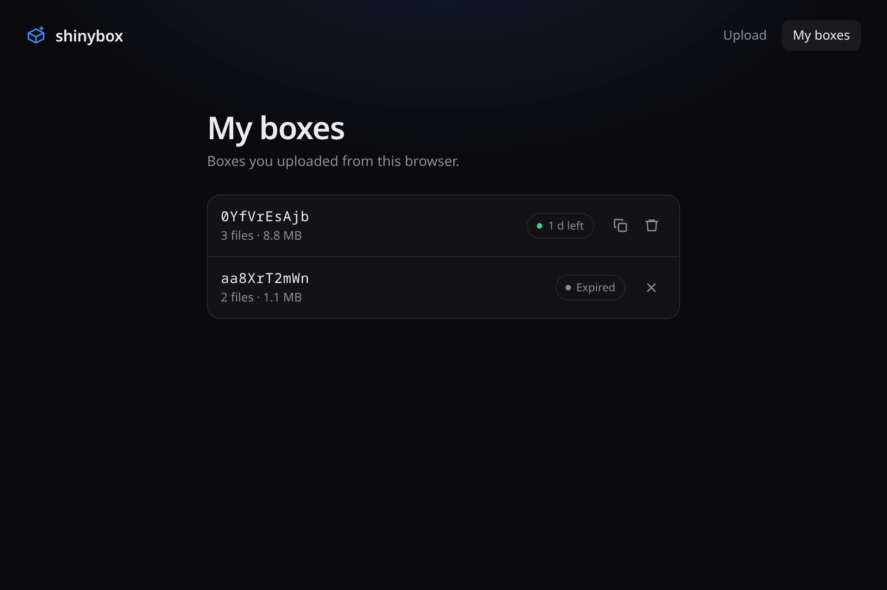

# shinybox

[](https://github.com/mordisk10/shinybox/actions/workflows/ci.yml)
[](https://github.com/mordisk10/shinybox/releases)
[](LICENSE)

A tiny self-hosted file drop. Upload files, share a link, and let them expire.

shinybox is a single binary with no external services: files live on disk, metadata lives in an
embedded SQLite database, and the web interface is compiled into the executable.



| Shared box | My boxes |
| --- | --- |
|  |  |

## Features

- **Boxes, not folders.** Each upload becomes a box with an unguessable share link like `/b/k7Qm2xPa9L`.
- **Everything expires.** Uploaders pick a lifetime (1 hour, 1 day, 7 days by default) and expired boxes are swept from disk automatically.
- **Delete early.** Every upload returns a secret delete token. The web interface remembers it in your browser under *My boxes*.
- **No accounts.** Uploads are open by default, or locked behind a single bearer token.
- **curl friendly.** One request to upload, plain JSON back.
- **Safe by default.** Files are stored under random ids, never under client-supplied names; downloads are always served as attachments with a sandboxing CSP; size limits are enforced on the actual bytes received.

## Quick start

### Docker

```sh
docker run -d -p 8080:8080 -v shinybox-data:/data ghcr.io/mordisk10/shinybox
```

or with the included [`compose.yaml`](compose.yaml):

```sh
docker compose up -d
```

### Prebuilt binary

Download the archive for your platform from the [releases page](https://github.com/mordisk10/shinybox/releases), extract it and run:

```sh
./shinybox
```

### From source

Requires Rust 1.89 or newer.

```sh
cargo install --git https://github.com/mordisk10/shinybox
shinybox --bind 0.0.0.0:8080
```

Then open <http://localhost:8080>.

## Configuration

Settings come from a TOML file, which is optional. shinybox reads `./shinybox.toml` if it exists, or the file passed
with `--config`. A few settings can also be overridden with flags or environment variables. See
[`shinybox.example.toml`](shinybox.example.toml) for an annotated example.

| Key | Flag / environment variable | Default | Description |
| --- | --- | --- | --- |
| `bind` | `--bind` / `SHINYBOX_BIND` | `127.0.0.1:8080` | Address to listen on |
| `data-dir` | `--data-dir` / `SHINYBOX_DATA_DIR` | `data` | Database and uploaded files |
| `public-url` | `--public-url` / `SHINYBOX_PUBLIC_URL` | from request | Base URL used in share links |
| `upload-token` | `--upload-token` / `SHINYBOX_UPLOAD_TOKEN` | unset | Require `Authorization: Bearer <token>` to upload |
| `max-upload-size` | | `10 MB` | Combined size of all files in a box |
| `max-files` | | `3` | Files per box |
| `default-expiry` | | `1day` | Lifetime when the uploader does not choose one |
| `max-expiry` | | `7days` | Longest lifetime an uploader may choose |

Durations use [humantime](https://docs.rs/humantime) syntax (`30m`, `12h`, `3days`). Log verbosity follows
`RUST_LOG`, e.g. `RUST_LOG=debug`.

### Behind a reverse proxy

Set `public-url` so share links point at your public address, and raise the proxy's body size limit to at least
`max-upload-size`. For nginx:

```nginx
location / {
    proxy_pass http://127.0.0.1:8080;
    client_max_body_size 20m;
}
```

## API

All responses are JSON. Errors look like `{"error": "not found"}` with a matching HTTP status.

| Method | Path | Description |
| --- | --- | --- |
| `POST` | `/api/boxes` | Create a box from a multipart form |
| `GET` | `/api/boxes/{code}` | Box details and file list |
| `GET` | `/api/boxes/{code}/files/{id}` | Download a file (supports range requests) |
| `DELETE` | `/api/boxes/{code}` | Delete a box, requires `X-Delete-Token` |
| `GET` | `/api/info` | Upload limits of this server |
| `GET` | `/health` | Liveness check, returns `ok` |

### Upload

Send one `file` field per file and, optionally, an `expires` field:

```sh
curl -F file=@report.pdf -F file=@photo.jpg -F expires=1h https://box.example.com/api/boxes
```

```json
{
  "code": "k7Qm2xPa9L",
  "url": "https://box.example.com/b/k7Qm2xPa9L",
  "created_at": 1795694400,
  "expires_at": 1795698000,
  "files": [
    { "id": "V5JPgMwqH6dNepeQ", "name": "report.pdf", "size": 318204, "content_type": "application/pdf" },
    { "id": "q2LxW0bTn8RkYc3Z", "name": "photo.jpg", "size": 2410022, "content_type": "image/jpeg" }
  ],
  "delete_token": "b1Zr0…"
}
```

The delete token is only returned once. When the server requires an upload token, add
`-H "Authorization: Bearer <token>"`.

### Download and delete

```sh
curl -OJ https://box.example.com/api/boxes/k7Qm2xPa9L/files/V5JPgMwqH6dNepeQ
curl -X DELETE -H "X-Delete-Token: b1Zr0…" https://box.example.com/api/boxes/k7Qm2xPa9L
```

## Development

```sh
cargo test                                  # unit and end-to-end API tests
cargo clippy --all-targets -- -D warnings
cargo fmt --check
```

The server lives in `src/` (one module per concern: config, storage, database, upload handling, routes) and the
web interface is plain HTML, CSS and JavaScript in `web/`, with no build step.

## License

[MIT](LICENSE)
