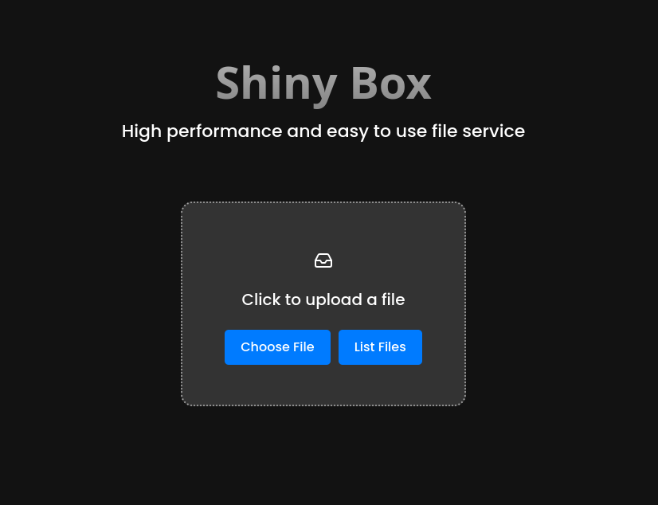
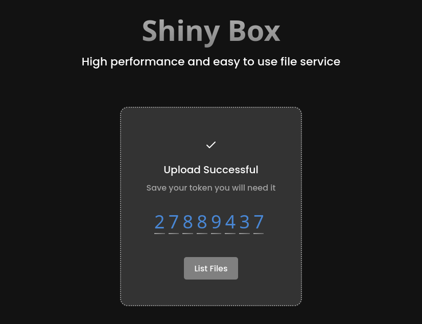
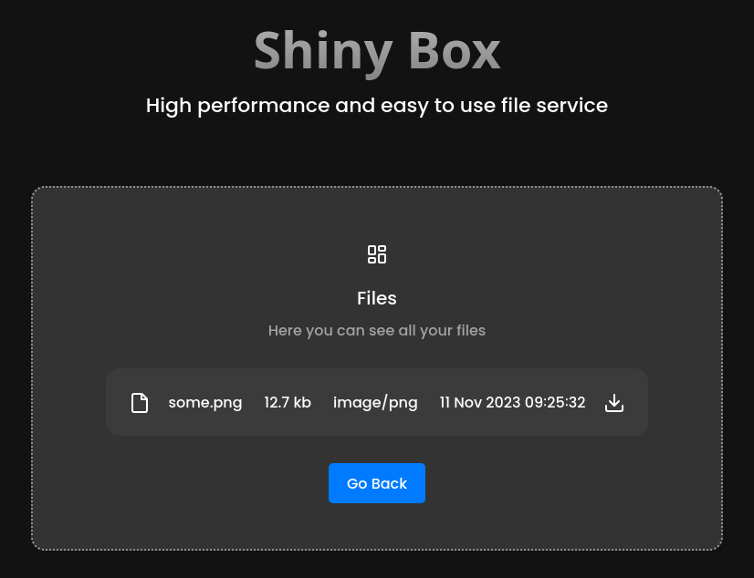

# ShinyBox


> This is a lightweight Rust-based web server and a website that provides file upload, listing, and download functionality.

<div style="text-align:center; letter-spacing: 1rem">
   
   
   
</div>

## Getting Started

Follow these steps to get ShinyBox up and running on your local machine:

1. **Clone the Repository:**

   ```shell
   git clone https://github.com/ShinyMC/shinybox.git
   ```

2. **Build the Project:**

   ```shell
   cd shinybox
   cargo build --release
    ```

3. **Run the Server:**

    ```shell
    cargo run
    ```

The server will start and be accessible at `http://localhost:8080`

## Contributing 

We welcome contributions from the community! If you'd like to improve ShinyBox, please fork the repository, make your changes, and submit a pull request.
